  

<h1 align="center">Hi, I'm Patrick</h1>

  <b>Engineering manager in robotics</b> — I lead teams building the software that lets robots <b>see</b>, <b>decide</b>, and <b>move</b>. 
  Most of my work lives where computer vision, ROS&nbsp;2, machine learning and robotic arms meet, 
  backed by automated tests so the hardware does exactly what the code says.

  
  

| **Focus** | **Builds** | **Ships with** |
|:---:|:---:|:---:|
| Robotics software | Perception · Motion · ML | Automated tests & CI |

<h2 align="center">Skills</h2>

● <b>filled</b> = core skill &nbsp;·&nbsp; ○ <b>outlined</b> = tools &amp; techniques

<h3 align="center">Robotics &amp; ROS</h3>

Arms, middleware and motion — the hardware-facing side.

  
  
  
  
  
  
  
  
  
  
  

<h3 align="center">Computer Vision</h3>

Turning camera and depth data into something a robot can act on.

  
  
  
  
  
  
  
  

<h3 align="center">Machine Learning &amp; Model Making</h3>

Building, training and shipping models for perception.

  
  
  
  
  
  
  
  
  

<h3 align="center">Testing &amp; Automation</h3>

Proving it works in simulation before it moves in the real world.

  
  
  
  
  
  
  
  

<h3 align="center">Languages</h3>

  
  
  
  
  
  

<h3 align="center">Cloud, Data &amp; Tooling</h3>

  
  
  
  
  
  

<h3 align="center">Off the Clock</h3>

When I'm not working on robots.

  
  

  

<!-- Add contact links in the GitHub badge row near the top, e.g.:

-->
